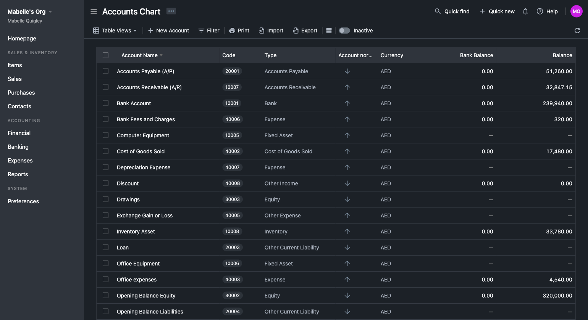
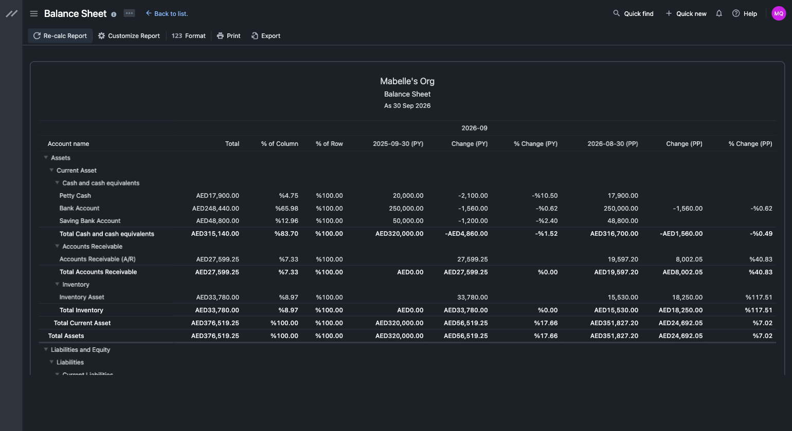
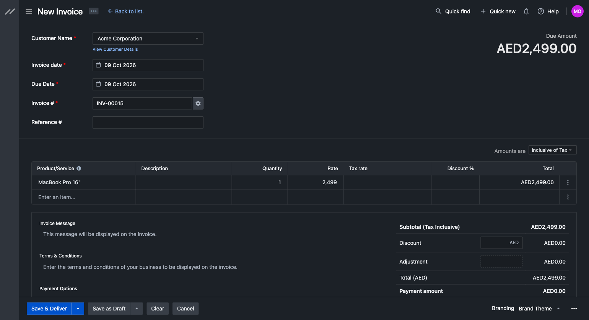

<div align="right">

# سامانه مالی پشیز

نسخهٔ فارسی‌شدهٔ [Bigcapital](https://github.com/bigcapitalhq/bigcapital) با تقویم شمسی.

</div>

نرم‌افزار حسابداری متن‌باز، با رابط راست‌به‌چپ، تقویم جلالی، ارقام فارسی و
واحد پول ریال و تومان.

| | |
|---|---|
| تقویم | جلالی در نمایش، ورودی و دوره‌های گزارش |
| زبان | فارسی کامل در رابط کاربری، چاپ و لینک اشتراک‌گذاری |
| ارز | ریال و تومان، افزون بر ارزهای موجود |
| داده‌های اولیه | نمودار حساب‌ها، انبار، نرخ‌های مالیات و قالب‌های چاپ، همه فارسی |

تاریخ‌ها همچنان میلادی ذخیره و از API رد و بدل می‌شوند؛ جلالی فقط جایی است
که تاریخ برای انسان خوانده می‌شود.

## پیش‌نیازها

| | کمینه | پیشنهادی |
|---|---|---|
| اوبونتو | ۲۲٫۰۴ | ۲۴٫۰۴ |
| حافظه | ۴ گیگ + swap | ۸ گیگ |
| دیسک | ۱۰ گیگ | ۲۰ گیگ |
| پورت | ۸۰ | ۸۰ و ۴۴۳ (برای HTTPS) |

ساخت رابط کاربری سنگین‌ترین کار این نرم‌افزار است؛ اگر مجموع حافظه و swap
کمتر از ۸ گیگ باشد، `setup.sh` و `update.sh` خودشان یک فایل swap چهار
گیگابایتی می‌سازند تا build در میانهٔ کار کشته نشود.

## نصب

دو راه نصب هست؛ هر دو از روی منبع همین مخزن build می‌کنند، پس در هر دو حالت
همهٔ تغییرهای این فورک در ایمیج‌ها هست:

- **راه ۱ (پیشنهادی):** یک اسکریپت که همه‌چیز را خودکار می‌کند.
- **راه ۲:** ‏`docker compose` دستی با یک فایل یکپارچه
  (`docker-compose.standalone.yml`)، برای وقتی که می‌خواهید هر گام و هر تنظیم
  را خودتان ببینید.

### راه ۱ — اسکریپت نصب (پیشنهادی)

```bash
git clone -b pashiz https://github.com/Mehbang/Pashiz.git /opt/pashiz
cd /opt/pashiz
sudo ./setup.sh
```

روی یک اوبونتوی خالی همین کافی است: داکر را نصب می‌کند، `.env` را با رمزهای
تصادفی می‌سازد، ایمیج‌ها را از روی همین منبع می‌سازد، پایگاه‌داده را مهاجرت
می‌دهد و همه‌چیز را بالا می‌آورد. در پایان نشانی دسترسی را چاپ می‌کند.

هنگام نصب دامنه را می‌پرسد؛ اگر بدهید HTTPS با گواهی خودکار Let's Encrypt
روشن می‌شود.

<details>
<summary>نصب یک‌خطی (بدون پرسش دامنه)</summary>

```bash
curl -fsSL https://raw.githubusercontent.com/Mehbang/Pashiz/pashiz/setup.sh | sudo bash
```

چون ورودی از لوله می‌آید، پرسشی نمایش داده نمی‌شود و روی HTTP نصب می‌کند.
برای HTTPS دامنه را از پیش بدهید:

```bash
curl -fsSL https://raw.githubusercontent.com/Mehbang/Pashiz/pashiz/setup.sh \
  | sudo PASHIZ_DOMAIN=hesab.example.ir bash
```

</details>

<details>
<summary>اگر Docker Hub در دسترس نیست</summary>

ایمیج‌های پایه از Docker Hub می‌آیند. یک آینه بدهید:

```bash
sudo DOCKER_REGISTRY_MIRROR=https://docker.arvancloud.ir ./setup.sh
```

اسکریپت پیش از شروع ساخت دسترسی را می‌آزماید و اگر برقرار نبود همان‌جا با
پیام روشن می‌ایستد.

</details>

### راه ۲ — نصب دستی با docker compose

برای وقتی که می‌خواهید فایل compose و همهٔ تنظیم‌ها را خودتان ببینید و اداره
کنید. در سه گام:

**۱) منبع و رمزها.** رمزها را با اسکریپت در یک فایل `.env` بسازید:

```bash
git clone -b pashiz https://github.com/Mehbang/Pashiz.git /opt/pashiz
cd /opt/pashiz
./scripts/gen-secrets.sh
```

‏`gen-secrets.sh` یک `.env` کامل می‌سازد: رمز پایگاه‌داده، کلید JWT، کلیدهای
Garage، مقدار ClickHouse و نشانی و کلید نشستِ صفحهٔ مدیریت. اجرای دوباره‌اش
بی‌خطر است و رمزهای پرشده را عوض نمی‌کند. سپس در `.env`:

- ‏`BASE_URL` را به نشانی‌ای که کاربر در مرورگر می‌بیند بگذارید.
- برای HTTPS، ‏`PASHIZ_DOMAIN` را هم پر کنید.

**۲) بالا آوردن سرویس‌ها.** همهٔ تنظیم‌ها از `.env` خوانده می‌شوند. یک فایل
یکپارچه و خودبسنده برای همین هست — `docker-compose.standalone.yml` — که همهٔ
سرویس‌ها و صفحهٔ مدیریت را در خود دارد و از روی منبع build می‌کند:

```bash
docker compose -f docker-compose.standalone.yml --env-file .env up -d --build
```

برای HTTPS، در `.env` این سه مقدار را بگذارید تا فقط Caddy روی ۸۰/۴۴۳ بماند و
تضاد پورت پیش نیاید، سپس profile را روشن کنید:

```bash
# در .env:
#   PASHIZ_DOMAIN=hesab.example.ir
#   PUBLIC_PROXY_PORT=127.0.0.1:8080
#   PUBLIC_PROXY_SSL_PORT=127.0.0.1:8443
docker compose -f docker-compose.standalone.yml --profile https \
  --env-file .env up -d --build
```

> ‏`docker-compose.standalone.yml` معادلِ یک‌فایلیِ جفتِ
> `docker-compose.prod.yml` + `docker-compose.pashiz.yml` است — همان نام
> کانتینرها و همان volumeها — منهای دو سرویسی که این فورک اجرا نمی‌کند
> (ClickHouse و watchtower). `setup.sh` و `update.sh` از آن جفت استفاده
> می‌کنند؛ این فایل برای وقتی است که می‌خواهید همه‌چیز را در یک compose ببینید.
> هم‌زمان فقط یکی را بالا نگه دارید.

> روی سروری با حافظهٔ کم، build همزمانِ دو ایمیج ممکن است با `signal: killed`
> کشته شود. راه ۱ این را مدیریت می‌کند (swap و build یکی‌یکی). در راه دستی اگر
> چنین شد، `sudo ./setup.sh` را روی همان `.env` موجود اجرا کنید؛ آن را
> بازنویسی نمی‌کند و فقط کارهای مانده را انجام می‌دهد.

**۳) فضای پیوست‌ها و صفحهٔ مدیریت.** یک `up` ساده کانتینرها را بالا می‌آورد،
اما دو کار آخر را خودکار نمی‌کند: ساخت کلید S3 در Garage (برای پیوست‌ها و
لوگو) و ساخت گذرواژهٔ صفحهٔ مدیریت. ساده‌ترین راه، اجرای اسکریپت نصب روی همان
`.env` است — چون idempotent است، فقط همین دو را تکمیل می‌کند:

```bash
sudo ./setup.sh
```

گذرواژهٔ صفحهٔ مدیریت را در هر زمان می‌توان با `sudo ./update.sh admin` ساخت
یا عوض کرد.

## به‌روزرسانی و نگهداری

همهٔ کارهای روزمره با `update.sh` انجام می‌شود. به‌روزرسانی پیش از هر کار
پشتیبان می‌گیرد، `.env` را دست نمی‌زند و هیچ volume‌ای را پاک نمی‌کند.

```bash
cd /opt/pashiz

sudo ./update.sh                 # دریافت نسخهٔ تازه، پشتیبان، ساخت و راه‌اندازی
sudo ./update.sh rebuild         # ساخت دوباره بدون دریافت نسخهٔ تازه
sudo ./update.sh rollback        # بازگشت به نسخهٔ پیش از آخرین به‌روزرسانی
     ./update.sh backup          # بایگانی: پایگاه‌داده + پیوست‌ها + کلیدها
sudo ./update.sh restore <فایل>  # بالا آوردن یک بایگانی روی این نصب
     ./update.sh status          # وضعیت سرویس‌ها
     ./update.sh logs [سرویس]    # دنبال‌کردن گزارش‌ها
     ./update.sh start|stop|restart

sudo ./update.sh https hesab.example.ir  # روشن‌کردن HTTPS روی نصب موجود
sudo ./update.sh https off               # بازگشت به HTTP
```

## صفحهٔ مدیریت (پنل مدیریت)

صفحهٔ مدیریت یک کانتینر جدا نیست؛ درون همان سرور است و روی نشانی‌ای تصادفی و
حدس‌نزدنی سرو می‌شود:

```
<BASE_URL>/api/admin/<PASHIZ_ADMIN_PATH>
```

از آنجا می‌توانید کاربران و سازمان‌ها را ببینید، ثبت‌نام را باز و بسته کنید،
‏SMTP را تنظیم و آزمایش کنید و پشتیبان بگیرید. نشانی و اعتبارنامه را `setup.sh`
هنگام نصب می‌سازد و یک‌بار نشان می‌دهد. بعداً:

```bash
./update.sh admin-url    # نشان‌دادن نشانی صفحه (بدون نیاز به sudo)
sudo ./update.sh admin   # ساخت یا تعویض نام کاربری و گذرواژه
```

گذرواژه با scrypt درهم‌سازی می‌شود و متن اصلی هیچ‌جا نوشته نمی‌شود؛ اعتبارنامه
در `.env` می‌ماند نه در پایگاه‌داده. پس از پنج تلاش ناموفق، آن IP پانزده دقیقه
بسته می‌شود و هر ردِّ وجودِ صفحه ۴۰۴ می‌گیرد. جزئیات کامل امنیتی در
**[DEPLOY.md](DEPLOY.md)**.

## رمزها و مقادیر تصادفی

نصب به چند مقدار تصادفی نیاز دارد. دو راه برای ساختنشان هست — «یک فایل» یا
«ترمینال»:

**راه فایل — همه را یکجا:**

```bash
./scripts/gen-secrets.sh
```

یک `.env` کامل می‌سازد یا کامل می‌کند؛ اجرای دوباره رمزهای موجود را عوض
نمی‌کند و هیچ مقداری را چاپ نمی‌کند (جز نشانی صفحهٔ مدیریت).

<details>
<summary>راه ترمینال — تک‌تک و دستی</summary>

هرکدام را ساخته و در `.env` بگذارید:

```bash
openssl rand -hex 32   # APP_JWT_SECRET      — امضای توکن ورود
openssl rand -hex 24   # DB_PASSWORD         — رمز کاربر پایگاه‌داده
openssl rand -hex 24   # DB_ROOT_PASSWORD    — رمز root پایگاه‌داده
openssl rand -hex 32   # GARAGE_RPC_SECRET   — فضای S3 پیوست‌ها
openssl rand -hex 32   # GARAGE_ADMIN_TOKEN
openssl rand -hex 24   # CLICKHOUSE_PASSWORD — لازم است حتی وقتی ClickHouse خاموش است
openssl rand -hex 32   # PASHIZ_ADMIN_PATH   — بخش تصادفی نشانی صفحهٔ مدیریت
openssl rand -hex 32   # PASHIZ_ADMIN_SECRET — کلید امضای نشست صفحهٔ مدیریت
```

گذرواژهٔ صفحهٔ مدیریت را خودِ `update.sh` درهم‌سازی می‌کند (داخل ایمیج، تا
متن اصلی جایی نوشته نشود). اگر خواستید دستی:

```bash
printf '%s' 'گذرواژه‌تان' \
  | docker run --rm -i pashiz/server:latest \
      node packages/server/scripts/hash-admin-password.js
# خروجی را در PASHIZ_ADMIN_PASSWORD_HASH بگذارید
```

</details>

## همهٔ تنظیمات

هر تنظیمی در `.env` است؛ نمونهٔ کامل با توضیح هر کلید در
[`.env.example`](.env.example) است و `gen-secrets.sh` از روی همان می‌سازد.
مهم‌ترین گروه‌ها:

| گروه | کلیدها |
|---|---|
| **برنامه** | `BASE_URL`، `PASHIZ_DOMAIN`، `PUBLIC_PROXY_PORT`، `PUBLIC_PROXY_SSL_PORT` |
| **رمزها (لازم)** | `APP_JWT_SECRET`، `DB_PASSWORD`، `DB_ROOT_PASSWORD`، `GARAGE_RPC_SECRET`، `GARAGE_ADMIN_TOKEN`، `CLICKHOUSE_PASSWORD` |
| **صفحهٔ مدیریت** | `PASHIZ_ADMIN_PATH`، `PASHIZ_ADMIN_SECRET`، `PASHIZ_ADMIN_USERNAME`، `PASHIZ_ADMIN_PASSWORD_HASH` |
| **ثبت‌نام** | `SIGNUP_DISABLED`، `SIGNUP_ALLOWED_DOMAINS`، `SIGNUP_ALLOWED_EMAILS`، `SIGNUP_EMAIL_CONFIRMATION` |
| **ایمیل (SMTP)** | `MAIL_HOST`، `MAIL_PORT`، `MAIL_USERNAME`، `MAIL_PASSWORD`، `MAIL_FROM_ADDRESS`، `MAIL_FROM_NAME` |
| **محدودیت نرخ** | `THROTTLE_GLOBAL_TTL`/`_LIMIT`، `THROTTLE_AUTH_TTL`/`_LIMIT` |
| **پیوست‌ها (S3/Garage)** | `S3_ENDPOINT`، `S3_BUCKET`، `S3_ACCESS_KEY_ID`، `S3_SECRET_ACCESS_KEY`، `S3_REGION`، `S3_FORCE_PATH_STYLE` |
| **چاپ PDF** | `GOTENBERG_URL`، `GOTENBERG_DOCS_URL` |
| **اختیاری** | `PLAID_*`، `STRIPE_*`، `OPEN_EXCHANGE_RATE_APP_ID`، `BANK_FEED_ENABLED` |

راهنمای کامل پشتیبان‌گیری، دامنه، عیب‌یابی و جزئیات امنیتی:
**[DEPLOY.md](DEPLOY.md)**

## پس از نصب

نشانی را در مرورگر باز کنید و نخستین سازمان را بسازید. **هنگام ساخت سازمان
زبان «فارسی» را انتخاب کنید** — تقویم شمسی، ارقام فارسی، نمودار حساب‌ها،
انبار، نرخ‌های مالیات و نام ارزها همه بر پایهٔ همین تنظیم ساخته می‌شوند.

---

# Upstream — Bigcapital

Pashiz is a fork of Bigcapital. Everything below is the upstream project's own
README, kept as it is: the accounting engine, the API and the data model are
theirs, and this fork adds the Persian localisation and the Jalali calendar on
top. Bigcapital is licensed AGPL-3.0; so is this fork.

<p align="center">
  <p align="center">
    <a href="https://bigcapital.app" target="_blank">
      
    </a>
  </p>
  <p align="center">
    Simple, smart online accounting software for small and medium businesses.
  </p>

  <p align="center">
    <a href="https://github.com/bigcapitalhq/bigcapital/commits/develop">
      
    </a>
    <a href="https://hub.docker.com/u/bigcapitalhq">
      
    </a>
    <a href="https://discord.com/invite/c8nPBJafeb">
      
    </a>
    <a href="https://github.com/bigcapitalhq/bigcapital/graphs/contributors">
      
    </a>
    <a href="https://github.com/bigcapitalhq/bigcapital/blob/develop/LICENSE">
      
    </a>
    <a href="https://twitter.com/bigcapitalhq"> 
      
    </a>
  </p>

  <p align="center">
    <a href="https://my.bigcapital.app">Bigcapital Cloud</a>
  </p>
</p>

# What's Bigcapital?

Bigcapital is a smart and open-source accounting and inventory software, Bigcapital keeps all business finances in right place and automates accounting processes to give the business powerful and intelligent financial statements and reports to help in making decisions.

<p align="center">
  
  
  
</p>

# Getting Started

We've got serveral options on dev and prod depending on your need to get started quickly with Bigcapital.

## Self-hosted 

Bigcapital is available open-source under AGPL license. You can host it on your own servers using Docker.

### Docker

To get started with self-hosted with Docker and Docker Compose, take a look at the [Docker guide](https://docs.bigcapital.app/deployment/docker).

## Development

### Local Setup

To get started locally, we have a [guide to help you](https://github.com/bigcapitalhq/bigcapital/blob/develop/CONTRIBUTING.md).

### Gitpod

- Click the Gitpod button below to open this project in development mode.
- This will open and configure the workspace in your browser with all the necessary dependencies.

[](https://gitpod.io/new/#https://github.com/bigcapitalhq/bigcapital)

## Headless Accounting

You can integrate Bigcapital API with your system to organize your transactions in double-entry system to get the best financial reports.

[](https://www.postman.com/bigcapital/workspace/bigcapital-api)

# Resources

- [Documentation](https://docs.bigcapital.app/) - Learn how to use.
- [API Reference](https://docs.bigcapital.app/api-reference) - API reference docs
- [Contribution](https://github.com/bigcapitalhq/bigcapital/blob/develop/CONTRIBUTING.md) - Welcome to any contributions.
- [Discord](https://discord.com/invite/c8nPBJafeb) - Ask for help.
- [Bug Tracker](https://github.com/bigcapitalhq/bigcapital/issues) - Notify us new bugs.

# Changelog

Please see [Releases](https://github.com/bigcapitalhq/bigcapital/releases) for more information what has changed recently.

# Contact us

Meet our sales team for any commercial inquiries.

<a target="_blank" href="https://cal.com/ahmed-bouhuolia-ekk3ph/30min"></a>

# Recognition

<a href="https://news.ycombinator.com/item?id=36118990">
  
</a>

# Contributors

Thanks goes to these wonderful people ([emoji key](https://allcontributors.org/docs/en/emoji-key)):

<!-- ALL-CONTRIBUTORS-LIST:START - Do not remove or modify this section -->
<!-- prettier-ignore-start -->
<!-- markdownlint-disable -->
<table>
  <tbody>
    <tr>
      <td align="center" valign="top" width="14.28%"><a href="https://github.com/abouolia"><br /><sub><b>Ahmed Bouhuolia</b></sub></a><br /><a href="https://github.com/bigcapitalhq/bigcapital/commits?author=abouolia" title="Code">💻</a></td>
      <td align="center" valign="top" width="14.28%"><a href="http://ameir.net"><br /><sub><b>Ameir Abdeldayem</b></sub></a><br /><a href="https://github.com/bigcapitalhq/bigcapital/issues?q=author%3Aameir" title="Bug reports">🐛</a></td>
      <td align="center" valign="top" width="14.28%"><a href="https://github.com/elforjani13"><br /><sub><b>ElforJani13</b></sub></a><br /><a href="https://github.com/bigcapitalhq/bigcapital/commits?author=elforjani13" title="Code">💻</a></td>
      <td align="center" valign="top" width="14.28%"><a href="https://scheibling.se"><br /><sub><b>Lars Scheibling</b></sub></a><br /><a href="https://github.com/bigcapitalhq/bigcapital/issues?q=author%3Ascheibling" title="Bug reports">🐛</a></td>
      <td align="center" valign="top" width="14.28%"><a href="https://github.com/suhaibaffan"><br /><sub><b>Suhaib Affan</b></sub></a><br /><a href="https://github.com/bigcapitalhq/bigcapital/commits?author=suhaibaffan" title="Code">💻</a></td>
      <td align="center" valign="top" width="14.28%"><a href="https://github.com/KalliopiPliogka"><br /><sub><b>Kalliopi Pliogka</b></sub></a><br /><a href="https://github.com/bigcapitalhq/bigcapital/issues?q=author%3AKalliopiPliogka" title="Bug reports">🐛</a></td>
      <td align="center" valign="top" width="14.28%"><a href="https://me.kochie.io"><br /><sub><b>Robert Koch</b></sub></a><br /><a href="https://github.com/bigcapitalhq/bigcapital/commits?author=kochie" title="Code">💻</a></td>
    </tr>
    <tr>
      <td align="center" valign="top" width="14.28%"><a href="http://cschuijt.nl"><br /><sub><b>Casper Schuijt</b></sub></a><br /><a href="https://github.com/bigcapitalhq/bigcapital/issues?q=author%3Acschuijt" title="Bug reports">🐛</a></td>
      <td align="center" valign="top" width="14.28%"><a href="https://github.com/ANasouf"><br /><sub><b>ANasouf</b></sub></a><br /><a href="https://github.com/bigcapitalhq/bigcapital/commits?author=ANasouf" title="Code">💻</a></td>
      <td align="center" valign="top" width="14.28%"><a href="https://ragnarlaud.dev"><br /><sub><b>Ragnar Laud</b></sub></a><br /><a href="https://github.com/bigcapitalhq/bigcapital/issues?q=author%3Axprnio" title="Bug reports">🐛</a></td>
      <td align="center" valign="top" width="14.28%"><a href="https://github.com/asenawritescode"><br /><sub><b>Asena</b></sub></a><br /><a href="https://github.com/bigcapitalhq/bigcapital/issues?q=author%3Aasenawritescode" title="Bug reports">🐛</a></td>
      <td align="center" valign="top" width="14.28%"><a href="https://snyder.tech"><br /><sub><b>Ben Snyder</b></sub></a><br /><a href="https://github.com/bigcapitalhq/bigcapital/commits?author=benpsnyder" title="Code">💻</a></td>
      <td align="center" valign="top" width="14.28%"><a href="http://vederis.id"><br /><sub><b>Vederis Leunardus</b></sub></a><br /><a href="https://github.com/bigcapitalhq/bigcapital/commits?author=cloudsbird" title="Code">💻</a></td>
      <td align="center" valign="top" width="14.28%"><a href="http://www.pivoten.com"><br /><sub><b>Chris Cantrell</b></sub></a><br /><a href="https://github.com/bigcapitalhq/bigcapital/issues?q=author%3Accantrell72" title="Bug reports">🐛</a></td>
    </tr>
    <tr>
      <td align="center" valign="top" width="14.28%"><a href="https://github.com/oleynikd"><br /><sub><b>Denis</b></sub></a><br /><a href="https://github.com/bigcapitalhq/bigcapital/issues?q=author%3Aoleynikd" title="Bug reports">🐛</a></td>
      <td align="center" valign="top" width="14.28%"><a href="https://myself.vercel.app/"><br /><sub><b>Sachin Mittal</b></sub></a><br /><a href="https://github.com/bigcapitalhq/bigcapital/issues?q=author%3Amittalsam98" title="Bug reports">🐛</a></td>
      <td align="center" valign="top" width="14.28%"><a href="https://www.camilooviedo.com/"><br /><sub><b>Camilo Oviedo</b></sub></a><br /><a href="https://github.com/bigcapitalhq/bigcapital/commits?author=Champetaman" title="Code">💻</a></td>
      <td align="center" valign="top" width="14.28%"><a href="https://nklmantey.com/"><br /><sub><b>Mantey</b></sub></a><br /><a href="https://github.com/bigcapitalhq/bigcapital/issues?q=author%3Anklmantey" title="Bug reports">🐛</a></td>
      <td align="center" valign="top" width="14.28%"><a href="https://d.sb/"><br /><sub><b>Daniel Lo Nigro</b></sub></a><br /><a href="https://github.com/bigcapitalhq/bigcapital/issues?q=author%3ADaniel15" title="Bug reports">🐛</a> <a href="https://github.com/bigcapitalhq/bigcapital/commits?author=Daniel15" title="Code">💻</a></td>
    </tr>
  </tbody>
</table>

<!-- markdownlint-restore -->
<!-- prettier-ignore-end -->

<!-- ALL-CONTRIBUTORS-LIST:END -->

This project follows the [all-contributors](https://github.com/all-contributors/all-contributors) specification. Contributions of any kind welcome!
